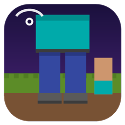

<p align="center"></p>

# First Person Body (Horizon mod)

See your own body in first person. Look down and your torso, legs and feet are there, moving as you walk, crouch and
fight, instead of the floating hand alone.

Client side only: it works in single player and on any server.

## What it does

- Draws your own player model in first person, with your skin, armour and cape.
- Hides your head, hat and helmet, and anything worn on the head, so the camera never looks out of your skull.
- Moves the body a little behind the camera so you don't see into your chest, a little more when you look down
  or crouch.
- Keeps the vanilla first-person hand and items by default, or shows the model's own arms instead.
- Steps aside while you swim, crawl, glide with an elytra, use a riptide spin or sleep, and for spectators.

## Settings

Options > Mods > First Person Body > **Config**. Each button steps through its values.

| Setting | Values | Default |
|---|---|---|
| First Person Body | OFF, ON | ON |
| Arms | Vanilla hand, Model arms | Vanilla hand |
| Body offset | None, Small, Normal, Large | Normal |
| While riding | OFF, ON | ON |
| Lean back looking down | OFF, ON | ON |

A **Toggle First Person Body** key turns it on and off in game; it starts unbound, set it in Options > Controls.

First Person Body 2.0 is made for Horizon's mod API, so its settings start from the defaults again once: the 1.x
settings files aren't read.

## Install

Made for Horizon **Nightly 2026-11-21 · 8f83e5c**.
It patches the game, so it builds only on that exact Horizon build: if the launcher lists it as
**Left out**, switch your instance to that Nightly, or wait for the version made for yours.

From GitHub:

1. Download `first_person_body-2.0.2.hmod` from the [latest release](https://github.com/selfmonoraque5/first-person-body/releases/latest).
2. Put it in the `horizon-native-mods` folder of your game folder, not in `mods`. On Windows that is
   `%APPDATA%\horizon\horizon-native-mods`.
3. In the launcher, open the Mods page and click **Build** (the first build downloads the mod SDK and takes a few
   minutes). After a build the launcher can look stuck for a while as it cleans its cache: let it finish.
4. When it says **Up to date**, play.

Once it is listed in the Horizon registry: Mods, find **First Person Body**, Install.

To build a local copy: `horizon-launcher native-build <this folder> --instance <instance> --trust-native-code`.

## Compatibility

Horizon has no hook for drawing your own player in first person, so besides the mod API's hooks this mod patches the
game's own functions (`[[native.mixin]]` in `horizon-mod.toml`). It works on the Horizon build it is made for; a later
Horizon that changes these functions needs an update of this mod:

| Patch | Where | What |
|---|---|---|
| RETURN | `game/interface/perspective.rs` `own_body_in_view` | the body is drawn in first person too |
| HEAD + RETURN | `game/interface/perspective.rs` `player_model_geometry` | marks while your own model is drawn; at the end, moves its vertices so the body stands a little behind the camera |
| HEAD (cancellable) | `game/mobs/mob_blocks.rs` `held_item_geometry`, `head_item_geometry`; `game/interface/perspective.rs` `player_ears_geometry`; `game/interface/player_hooks.rs` `own_layers_geometry` | no items, head items, ears or cosmetics at the camera |

And the mod API's hooks: `render_player_pre` hides the head (and the arms with the vanilla hand), `render_hand` and
`render_arm` leave out the vanilla hand with the model's arms, `register`, `setting_changed` and `client_tick_post`
keep the settings and the toggle key.

Everything acts only while your own first-person model is drawn: other players and mobs are untouched. The mod has no
network, file or process access beyond Horizon's own settings for the mod.

```sh
cargo test    # settings, the body offset and when the body shows
```

## Credits

Inspired by [First-person Model](https://modrinth.com/mod/first-person-model) by tr7zw. First Person Body is written
from scratch for Horizon and contains none of its code or assets; it is not made or endorsed by tr7zw.

## License

MIT, see [LICENSE](LICENSE).
