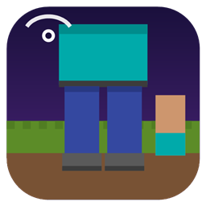

<p align="center"></p>

# First Person Body (Horizon native mod)

See your own body in first person. Look down and your torso, legs and feet are there, moving as you walk, crouch and
fight, instead of the floating hand alone.

Client side only: it works in single player and on any server.

## What it does

- Draws your own player model in first person, with your skin, armour and cape.
- Hides your head, hat and helmet, and anything worn on the head, so the camera never looks out of your skull.
- Moves the body a little behind the camera so you don't see into your chest, a little more when you look down
  or crouch.
- Keeps the vanilla first-person hand and items by default, or shows the model's own arms instead.
- Steps aside while you swim, crawl, glide with an elytra, use a riptide spin or sleep, and for spectators.

## Settings

Options > Mods > First Person Body > Settings. Each button steps through its values.

| Setting | Values | Default |
|---|---|---|
| First Person Body | OFF, ON | ON |
| Arms | Vanilla hand, Model arms | Vanilla hand |
| Body offset | None, Small, Normal, Large | Normal |
| While riding | OFF, ON | ON |
| Lean back looking down | OFF, ON | ON |
| Reset to defaults | | |

A **Toggle First Person Body** key turns it on and off in game; it starts unbound, set it in Options > Mods.

## Install

In the Horizon launcher: Mods, find **First Person Body**, Install, then **Build**. To try a local copy, put the
`.hnmod` in your instance's `horizon-native-mods/` folder and Build.

## Compatibility

Applied and compile-checked on Horizon Nightly `fdc87ae` (2026-11-08) with horizon-mixins `5a64af9`, also together
with Living Camera and Map Preview.

Horizon has no hook point for drawing your own player in first person, so besides hook points this mod hooks the
game's own rendering functions. A later Horizon that changes them needs an update of this mod:

| Hook | Where | What |
|---|---|---|
| RETURN | `game/perspective.rs` `own_body_in_view` | the body is drawn in first person too |
| HEAD + RETURN | `game/perspective.rs` `player_model_geometry` | marks while your own model is drawn |
| OVERWRITE | `mobs/anim.rs` `player_model_visibility` | the game's visibility, plus the head (and arms) hidden |
| RETURN | `mobs/render.rs` `base_transform` | the body a little behind the camera |
| HEAD (cancellable) | `game/mob_blocks.rs` `held_item_geometry`, `head_item_geometry`; `game/perspective.rs` `player_ears_geometry`; `game/cosmetics.rs` `cosmetics_geometry` | no items, head items, ears or cosmetics at the camera |
| HEAD | `native_render_hand` (hook point) | no vanilla hand with model arms |

Everything below `player_model_geometry` acts only while your own first-person model is drawn: other players and
mobs are untouched. The mod has no network, file or process access beyond Horizon's own settings files for the mod.

```sh
cargo test    # settings, the body offset and the hidden parts
```

## Credits

Inspired by [First-person Model](https://modrinth.com/mod/first-person-model) by tr7zw. First Person Body is written
from scratch for Horizon and contains none of its code or assets; it is not made or endorsed by tr7zw.

## License

MIT, see [LICENSE](LICENSE).
